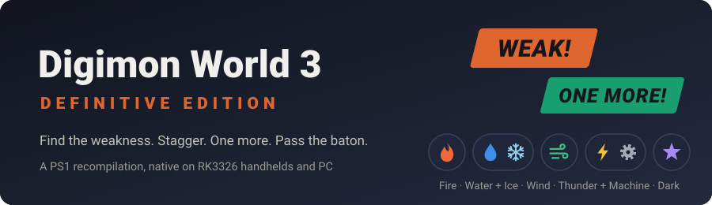
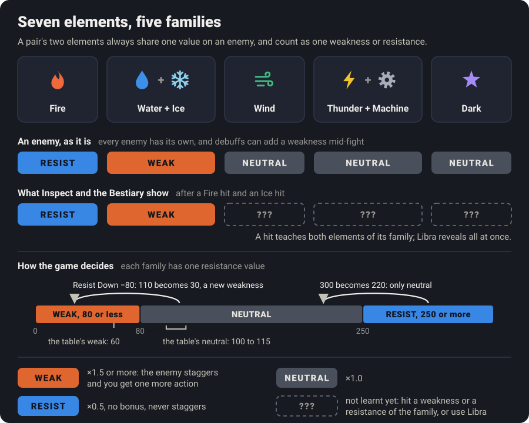
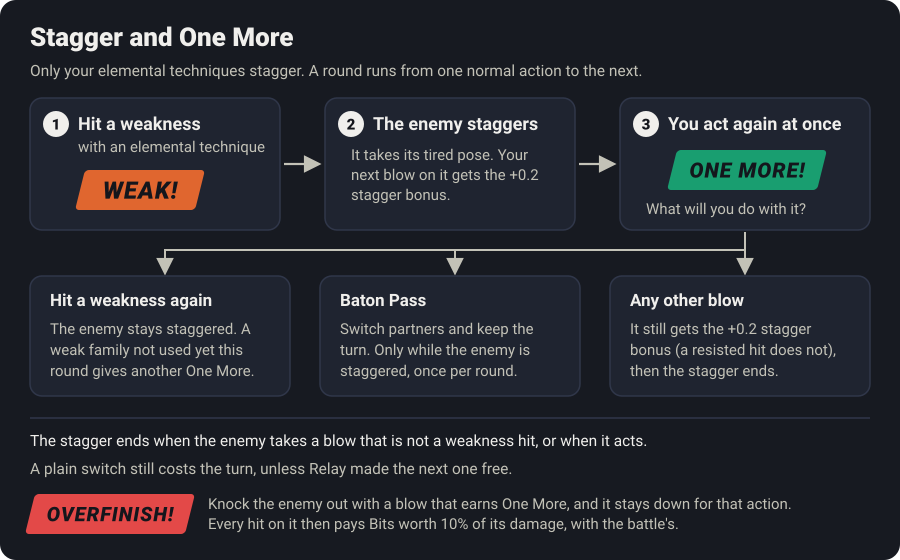
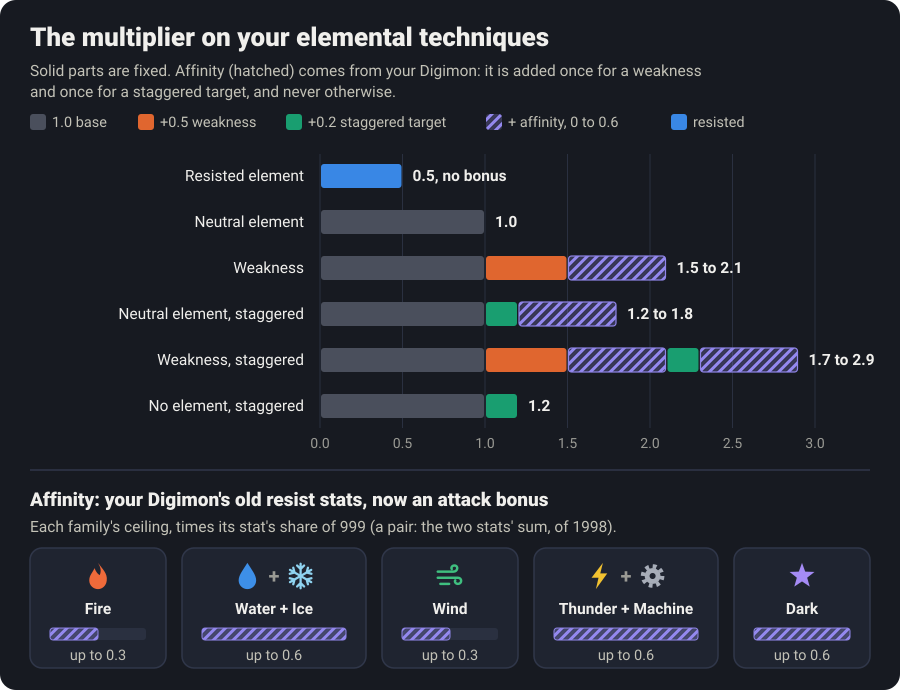
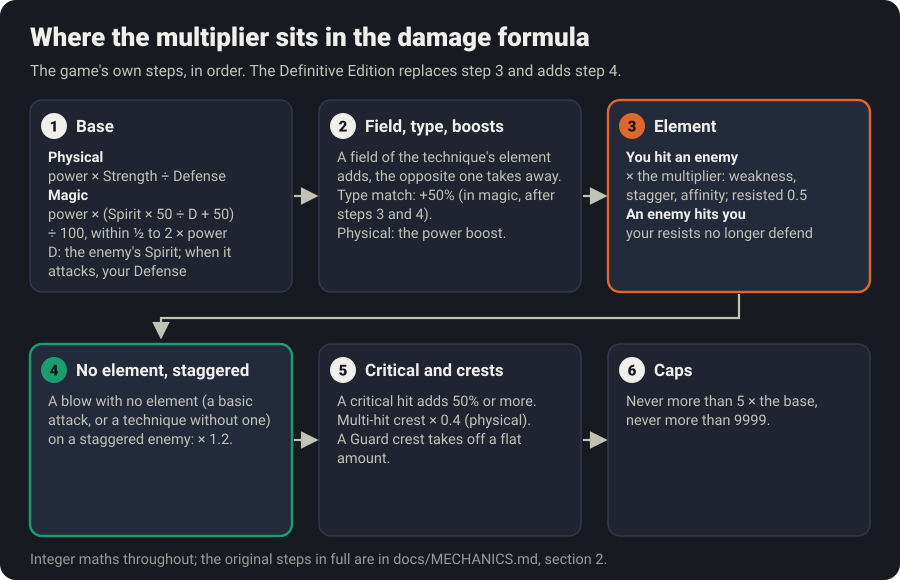
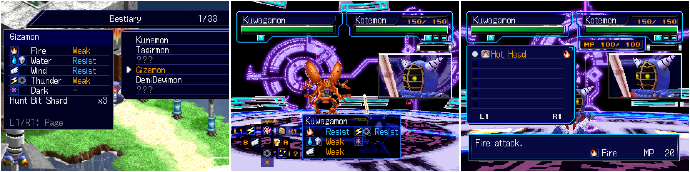
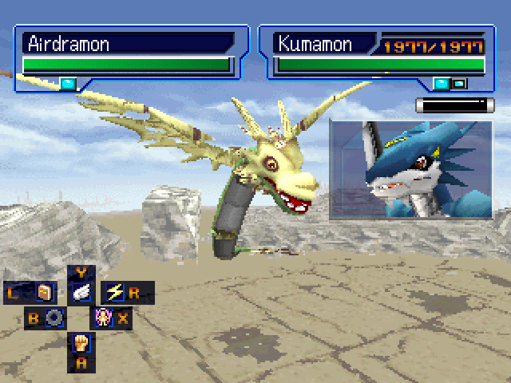
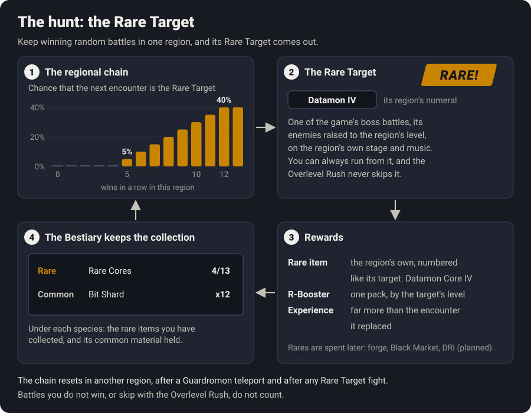
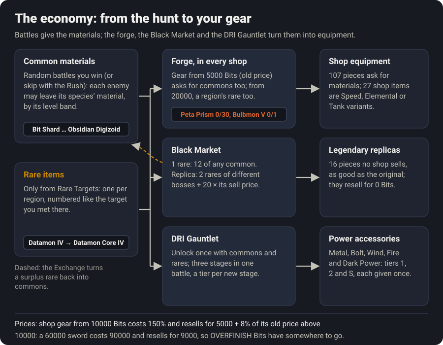

# Digimon World 3: Definitive Edition

*Digimon World 3* as it could have been: battles rebuilt around elemental weaknesses in the style of *Persona*, a
progression that respects your time, and the comforts a 2002 game never had. It runs natively, with no emulator, on
RK3326 handhelds (the R36S, the XF35H and their clones) and on PC.

- **Fights you think through.** Find the weakness, stagger the enemy, earn one more action, pass the baton.
- **Less grinding, same journey.** The late game arrives around level 40-50, where most players used to stop.
- **A reason to roam.** Every battle can drop Hunt Materials, a long winning streak in one region brings out its Rare
  Target, and what you collect pays for forged gear, Black Market replicas and the DRI Gauntlet.
- **Nothing hidden.** Enemy weaknesses, digivolution requirements and what each technique really does are on screen.
- **Your old save still works.**

It is built on the [Digimon World 2003 decompilation](https://github.com/gascarcella/dw2003recomp) and its PC port,
which are the upstream project's work; this fork adds the handheld path and the Definitive Edition.

> [!IMPORTANT]
> **This repository contains no game data.** You need your own copy of *Digimon World 2003 (Europe) (En,Fr,De,Es,It)*,
> raw `.bin` + `.cue`, MODE2/2352, 692,146,560 bytes, SHA-1 `457cb233349ba841e03b33d8060f8fbcadd45cb3`.
> This project is not affiliated with or endorsed by Bandai, Bandai Namco or Sony.

## Quick start

1. Download `dw3.zip` from the [releases](https://github.com/al4xdev/digimon-world-3-definitive-edition/releases) and unpack it into your PortMaster
   `ports` directory.
2. Copy your disc image into `ports/dw3/game/`.
3. Start *Digimon World 3* from the ports menu.

Install details, tested devices and known issues are on the player page, [`portmaster/README.md`](portmaster/README.md).

**Coming from an older version?** Your save opens and plays. To give it the new MP and TP tables, run
`tools/convert_save_mp.py card1.mcd` once (it keeps a backup).

## Where it runs

The work is focused on **RK3326 handhelds** for now: that is where everything is measured and tuned, on an XF35H. The
PC build works too. Once the Definitive Edition is finished, the focus moves to opening it up to more devices. If you
try it on another handheld, a report in the [issue tracker](https://github.com/al4xdev/digimon-world-3-definitive-edition/issues) helps a lot.

## Combat

### Weaknesses

Seven elements in five families: **Fire**, **Water + Ice**, **Wind**, **Thunder + Machine** and **Dark**. The two
elements of a pair always share one value on an enemy (both weak, both neutral or both resisted), so a pair counts as
one weakness or one resistance. Every enemy has its own, counted in families:

- most enemies are weak to two families and resist one;
- about one in five enemies up to level 30 is a "wall", weak to a single family and resisting two: find the weakness
  or struggle;
- from level 45 on, enemies are weak to two families and resist two, and so are bosses;
- the final boss is weak to one family and to Dark, and resists three;
- Dark is rare on both sides: only a handful of enemies are weak to it, and as few resist it. The four other families
  come out about even: of the 193 species, 93 are weak to Fire, 87 to Water + Ice, 94 to Wind and 93 to Thunder +
  Machine.

Each family has one resistance value: 80 or less is a weakness, 250 or more is resisted, anything between is neutral
(the enemy table uses 60 for a weakness and 100 to 115 for neutral). There is no cap on weaknesses, and they are read
at the moment of the hit, so a debuff that takes a neutral family to 80 or less adds one in the middle of a fight (see
[Buffs and debuffs](#buffs-and-debuffs)).

### Stagger and One More

Hitting a weakness with an elemental technique **staggers** the enemy (it takes its tired pose) and gives you **one
more** action. Each weak family gives its extra action once per round (a round starts with each normal action; an
extra one does not start a new round), so two weaknesses can chain into several actions in a row, but Ice after Water
gives none. Hitting a weakness again keeps the enemy staggered. Any other blow ends it, and still gets the stagger
bonus unless it hits a resistance; the enemy's own action ends it too. A blow with no element, or the element a crest
lends a basic attack, never staggers.

- **Baton Pass**: while the enemy is staggered, the Tag menu offers a free switch that keeps your turn (once per round).
  A plain switch still costs the turn, unless Relay made it free.
- **OVERFINISH**: a blow that knocks the enemy out and earns one more action leaves it lying there for that action.
  Every hit on it then shows **OVERFINISH!** and pays Bits worth 10% of its damage, added to the battle's.
- **You hear and see how a technique landed**: a slanted **WEAK!** or **RESIST!** over the enemy, and a distinct
  sound for a weakness, a neutral hit and a resisted one.
- **You open the fight** unless you are ambushed. Speed no longer decides who starts; a much faster side acts twice,
  and the HUD shows "Enemy x2" when it is the enemy.

### Damage

Damage is still the game's own formula. The Definitive Edition replaces the one step where the original read
elemental resistances, and adds a stagger bonus for blows with no element.

**The multiplier.** When your elemental technique hits an enemy:

| The hit | Multiplier |
|---|---|
| Neutral element | 1.0 |
| Weakness | 1.0 + 0.5 + affinity |
| Neutral element, staggered target | 1.0 + 0.2 + affinity |
| Weakness, staggered target | 1.0 + 0.5 + 0.2 + 2 × affinity |
| Resisted element | 0.5, no bonus, staggered or not |
| A blow with no element, staggered target | 1.0 + 0.2, no affinity |

**Affinity** is what your Digimon's old elemental "tolerance" stats became: they no longer defend, they strengthen your
attacks of that element. It is added once for a weakness and once for a staggered target, and never otherwise: on a
neutral hit against an enemy that is not staggered it does nothing. Each family has a ceiling, scaled by the stat's
share of its maximum, 999: Fire and Wind count on their own, up to 0.3; Water with Ice and Thunder with Machine count as
pairs, on the two stats' sum out of 1998, up to 0.6 (a Water and an Ice technique get the same affinity); Dark counts on
its own, up to 0.6. The strongest hit there is, a weakness on a staggered target with full affinity, is 2.3 for Fire or
Wind and 2.9 for the pairs and Dark.

One stat defends against everything: enemy magic is resisted by your **Defense**, and Spirit is purely your magic
attack. Your elemental stats no longer cut the damage enemy elements do to you.

#### The whole calculation

In the order the game runs it, all integer maths (every original step in full is in
[`docs/MECHANICS.md`](docs/MECHANICS.md), section 2):

1. **Base.**
   - Physical: `power × Strength ÷ Defense`.
   - Magic: `power × (Spirit × 50 ÷ D + 50) ÷ 100`, kept between half and twice the power. D is the enemy's Spirit
     when you attack, and your Defense when it attacks.
   - An enemy's power is first scaled by its battle's stat scale (`× stat_scale ÷ 16`).
   - Buffs and debuffs: physical ones act on Strength and Defense, as in the original. For magic, the attacker's Spirit
     is scaled by its Strength modifier and a defending enemy's Spirit by its Defense modifier (the final boss keeps
     its own); your Defense already carries yours.
2. **Field, type, boosts.** A field of the technique's element adds `field power ÷ 128` of the damage, the opposite
   element loses `field power ÷ 256`. A type match adds 50% (in magic, after steps 3 and 4). Physical blows add the
   attacker's power boost (`× power_up ÷ 64`).
3. **Element: the Definitive step.**
   - Your elemental technique on an enemy: `× the multiplier` above.
   - An enemy's elemental technique on you: physical `+ damage × element power × 2 ÷ 100`, magic unchanged. Both are
     the original formulas with your resistance fixed at the neutral 100, so your elemental stats no longer count.
   - A crest's element on your basic attack keeps the original bonus, read against the enemy's resistance.
4. **No element, staggered**: a blow with no element on a staggered enemy, `× 1.2`.
5. **Critical and crests**: a multi-hit crest `× 0.4` (physical), a critical hit adds about 50% to 150%, a Guard crest
   takes off a flat amount.
6. **Caps**: never more than 5 × the base, never more than 9999.

**A worked example**, checked against the port's code. Your Digimon has Spirit 180 and a Fire stat of 333. It casts a
Fire technique of power 100 at an enemy that fights with Spirit 120 and is weak to Fire; no field, no type match, no
critical hit.

| Step | Calculation | Result |
|---|---|---|
| Base | 100 × (180 × 50 ÷ 120 + 50) ÷ 100 = 100 × (75 + 50) ÷ 100 | 125 |
| Affinity | 0.3 × 333 ÷ 999 | 0.1 |
| First hit, a weakness | 125 × (1.0 + 0.5 + 0.1) = 125 × 1.6 | **200** |
| The One More: the same technique on the staggered enemy | 125 × (1.0 + 0.5 + 0.1 + 0.2 + 0.1) = 125 × 1.9 = 237.5 | **237** |
| The same hit if Fire were neutral, or resisted | 125 × 1.0, or 125 × 0.5 = 62.5 | 125, or 62 |

The second hit gives no further action (Fire already gave this round's), but it keeps the enemy staggered. The other
way round, an enemy's magic of power 100 (stat scale 16, so × 1) with Spirit 150 against your Defense 120 does
100 × (150 × 50 ÷ 120 + 50) ÷ 100 = 100 × (62 + 50) ÷ 100 = **112**, whatever your elemental stats.

### Buffs and debuffs

- An **attack buff** raises physical and magic damage alike; a **defense buff or debuff** counts against both kinds of
  hit. A magic party gets as much from them as a physical one.
- **Bosses are immune to status** (poison, sleep and the like) **but not to debuffs**: lowering a boss's defense or
  elemental resistance is part of the plan.
- **Resist Down** lowers the enemy's resistance to your strongest family (the one with your highest affinity, a pair
  counting both its elements) by 80, and **Mega Break** your two strongest families by 100 each, for three of the
  enemy's turns. On a neutral family that opens a weakness that was not there; a resisted one (300) only drops to
  neutral. In an enemy's hands the four remade techniques lower your affinities the same way.
- The HUD shows every active buff and debuff as an up or down arrow beside the Digimon, on both sides; a lowered
  elemental resistance shows as a down arrow in the element's colour, one per family.

### Knowing your enemy

- **Inspect** (a seventh button on the battle HUD, L2 by default) and **Start** show the enemy's five element families,
  but only what you have found out: hitting a weakness or a resistance with an elemental technique teaches both
  elements of its family, everything else shows `???`.
- **Libra** reveals all of an enemy's elements at once.
- The **Bestiary** (field menu) keeps what you learnt of every species, saved with your game, and lists its Hunt
  Materials: the common one with how many you hold, and its rare items as a collection (see [The hunt](#the-hunt)).
- The technique menu shows each technique's element; it and the status screens keep the seven element pictures.

### Techniques and MP

- Remade techniques: **Libra** (was Speed Up), **Relay** (was Mega Boost: the next switch is free, 50 MP), **Resist
  Down** (was Slow Down) and **Mega Break**.
- More techniques carry a secondary effect, so each form has its own role in a fight.
- Every technique description was rewritten from what the technique actually does, effect first: "Fire magic. Sleep
  chance."
- MP matters now, so the rookies that were starved of it are not any more: Kotemon, Kumamon, Monmon and Guilmon start
  with 140 MP and grow at the same pace as the others.

### Battle HUD

A direct-button HUD replaces the battle's list menu: each action (Fight, Tech, Digivolve, Tag, Item, Run, Inspect) has
its own button in a pad-shaped layout, rebindable from the launcher. It remembers the last technique and item, and
buffers a press made just before the menu opens.

## Progression

The original is known for ending at level 40-50 after exhausting grinding. The Definitive Edition brings the late game
to that same range without the grind.

### Training points

| Level | TP per level | Original |
|---|---|---|
| 2-20 | 7 | 5 |
| 21-40 | 9 | 5 |
| 41-50 | 30 | 5 |
| 51 and up | 0 | 5 |

By level 50 a Digimon has earned more TP than the original gives by level 99 (613 against 490). Levels 41 to 50 are
where you shape its stats the way you want. TP still caps at 99 in hand, so you train along the way instead of hoarding
for the last gym; the results screen tells you when a level-up lost TP to the cap.

### Training

- **Guaranteed training**: after three sessions without a perfect result, the fourth succeeds on every round. A perfect
  session resets the count, and the training screen shows where you stand.
- **Resistance training no longer costs a stat.**

### Experience

- A rookie levels at the original pace; **digivolution forms level 14 times faster**, so trying a new form is fun
  instead of a chore.
- **The party grows together**: a party member that stayed out of the fight earns the same experience as one that
  fought (one knocked out at the end earns none), and each Digimon's three chosen forms earn form experience whether
  they fought or not.
- **Card boosters drop 15 at a time**, so building a deck for the card game does not take a second playthrough.
- These were launcher mods (party experience, XP boost); they are the game's own rules now, with no switch. The Evo
  Buff mod is gone: weakness, stagger and the chain do its job.

### Digivolution

- **Requirements on screen**: the Digi-Lab shows what each next form needs and how far you are, for example
  "Greymon Lv 5 (3/5)" or "Strength 180 (142/180)". No guide needed.
- **Short animations**: a form's digivolution plays in full the first time, then a short version; hold a button to skip.

### Hard Mode

Choose it on New Game: your party is two Digimon instead of three. The third partner of the starting pack stays in the
lab, and the lab keeps the third slot closed. The choice is saved with the game.

## The hunt

Optional, and open all game long: every battle can drop Hunt Materials, and a winning streak in one region brings out
its rarest prey. The materials then pay for the forge, the Black Market and the DRI Gauntlet.

### The regional chain and the Rare Target

- Every random battle you win adds one to the **hunt chain** of the region you are in (an area of the world map; the
  server counts as its own). Moving to another region, a Guardromon teleport and fighting the Rare Target reset it.
  Battles you do not win, or skip with the Overlevel Rush, do not count. The chain is saved with your game.
- Past **5** wins, each random encounter in that region may be its **Rare Target** instead: a 20% chance at 6 wins,
  20% more per win, and **certain** at 10.
- The Rare Target is one of the game's boss battles, fought on the region's own stage and music, with its enemies
  raised to the region's level. A **RARE!** callout announces it, the Overlevel Rush never offers to skip it, and you
  can always run from it.
- Nearly every region with random encounters has one, and the same boss can be the Rare Target of several regions. It
  then carries its region's numeral ("Datamon IV") in battle, so it does not read as the same Digimon at a higher
  level.

### Hunt Materials

There are two kinds, and they do different jobs:

- **Common materials** drop in random battles (and in the ones the Overlevel Rush skips): any common Digimon you
  defeat may leave one, and its level band decides which, from Bit Shard on the weakest early Digimon to the Digizoids
  late in the game. They pile up as counts.
- **Rare items** drop only from Rare Targets, one per region that has a Rare Target. Each is a numbered variant of its
  target battle's item, with the numeral the target shows in battle: the region where you meet "Datamon IV" gives
  "Datamon Core IV". The Bestiary remembers every one you have ever found, so they are a collection to complete,
  region by region, even after you spend them.
- A Rare Target also drops one **R-Booster** pack, by the target's level, and pays far more experience than the
  encounter it replaced.
- **The Bestiary tells you where to hunt**: under each species it lists its common material with how many you hold,
  and its rare items as a collection.
- Rares are meant to be spent: the forge, the Black Market and the DRI Gauntlet below are where they go.

- Commons: a 25% chance per enemy defeated; sixteen of them, from the weakest level band to the strongest: Bit Shard,
  Byte Shard, Data Chip, Code Chip, Core Fragment, Core Crystal, Mega Crystal, Giga Crystal, Tera Prism, Peta Prism,
  then Chrome, Blue, Red, Gold, Black and Obsidian Digizoid. You hold up to 99 of each.
- Rares: 66, one per region with a Rare Target, up to 99 of each. Datamon is the Rare Target of 13 regions, so its
  rares run from Datamon Core I to Datamon Core XIII, and Datamon's Bestiary entry shows how many of them you have
  found, for example "Rare Cores 4/13".
- The results screen lists each one after the item: "Hunt material: Bit Shard x2" for commons, "Rare material:
  Datamon Core IV" for a rare.
- A Rare Target pays ten times the experience of the encounter it replaced. Its R-Booster is 01 below level 25, 02
  from 25, 03 from 40, 04 from 55 and 05 from 70.

### Spending them

What you collect pays for better gear: every shop is also a forge, a trader in the first town runs a Black Market,
and the DRI Agents open the Gauntlet.

### Prices

Advanced gear costs more and resells for much less, so the Bits from OVERFINISH have somewhere to go and a lucky find
no longer sells for a fortune. A weapon, armour or accessory that a shop sells for 10,000 Bits or more now costs 150%
of that, and resells for 5,000 plus 8% of its old price above 10,000 (never more than half the new price, rounded to
100): a 60,000 sword costs 90,000 and resells for 9,000 instead of 30,000, a 15,000 one costs 22,500 and resells for
5,400. Everything else keeps the game's prices.

### The forge

Shop equipment whose original price is 5,000 Bits or more asks for Hunt Materials as well as its Bits (107 pieces):

| Original price | Materials |
|---|---|
| Under 5,000 | None: Bits only, so the start of the game is unchanged |
| 5,000 to 19,999 | One common material, 10 to 25 of it |
| 20,000 and up | One of the seven strongest commons, 30 to 50 of it, and a region's rare item (two from 50,000) |

Select an item and its description shows what it takes against what you have, orange while you are short: "Peta Prism
0/30, Bulbmon V 0/1" (a rare is named by the Rare Target that drops it). Without them the shop refuses, as it does when
you lack the Bits ("You don't have enough materials."), and how many you can buy at once is capped by your materials.

### Equipment variants

The game has no free item slots, so 27 shop items were turned into variants in place: one of each kind in every shop
tier, each built around a style instead of a bigger number. They keep their icon, price and recipe, and a Digimon
already wearing one simply gets the new stats.

- **Speed** (one-handed weapons): half the power of the tier's best weapon, for Boost, from +5 in the first tier to +85
  in the last. With this edition's turn order, more Boost than the enemy means two actions before its first. Breeze
  Spear, Swift Pike, Quick Sword, Gale Saber, Zephyr Sword, Rapid Edge, Hayatemaru, Sonic Blade, Flash Sword.
- **Elemental** (head pieces): half the guard of the tier's best, for one family's resistances, which in this edition
  are your affinity: from +85 Fire to +355 Wind, about +0.03 to +0.11 on every WEAK! hit and again on a staggered
  target. Ember Band, Frost Visor, Gust Helmet, Volt Crown, Tide Cap, Circuit Helm, Shade Goggles, Blaze Crown, Tempest
  Crown.
- **Tank** (body armour and shields): 50% more guard than the tier's best, plus some Spirit, for a Boost penalty of −6
  to −30. Padded Coat, Quilted Suit, Heavy Shield, Bulwark Suit, Rampart Mail, Tower Shield, Fortress Vest, Aegis Wall,
  Titan Shield.

### The Black Market

A sleepy townsperson in a house of the first town (the same house later in the game) runs the Black Market. Talking
to them opens two tabs (L1/R1):

- **Exchange**: one rare item for 12 of any common material you pick, as long as all 12 fit under the 99 cap.
- **Replicas**: 16 pieces of equipment no shop sells, as good as the original: the seven Power S accessories,
  Machinegun, Magician Rod, Ghost Fang, Pulse Guard, Drill Horn, Chain Saw, Naginata, Recover Crest and MP Mega Proxy.
  Each costs two rare items of different bosses (Datamon IV and Datamon VII are the same boss), taken from your most
  plentiful ones and named before you confirm, plus 20 times the original's selling price in Bits: 20,000 to 40,000.
  A replica resells for 0 Bits, so the shop does not even offer to buy it.

### The DRI Gauntlet

Talk to a DRI Agent: once their own lines are over (their DDNA quest works as in the game), the list of simulations opens. Each replays a classic Tamer's battle data, who has a word for you before the fight and after it. Each is one battle against an evolution line's three stages,
Champion, Ultimate and Mega: when one falls the next comes in at full HP with a **DIGIVOLVE!** callout, while your
party keeps the HP, MP and items it has spent. There is no running away and no game over: lose and you are back on the
field with your HP and MP as they were before (spent items stay spent). A simulation is unlocked once, for good, by
handing in its materials.

| Line | Stages and levels | Unlock | Rewards |
|---|---|---|---|
| Terriermon (Guardromon) | Guardromon 24, Andromon 27, BK MegaGargomon 30 | Core Fragment ×15, Bulbmon Core I | Metal Power 1, 2, S |
| Veemon | Devidramon 32, Paildramon 35, BK Imperialdramon 38 | Core Crystal ×20, Datamon Core I | Bolt Power 1, 2, S |
| Patamon | Airdramon 40, MagnaAngemon 43, BK Seraphimon 46 | Tera Prism ×25, Bulbmon Core VII, Zanbamon Core VI | Wind Power 1, 2, S |
| Agumon | Tyrannomon 48, MetalGreymon 51, BK WarGreymon 54 | Gold Digizoid ×35, BK WarGreymon Core I, BK Imperialdramon Core XIII | Fire Power 1, 2, S |
| Guilmon | Flarerizamon 56, WarGrowlmon 59, BK WarGrowlmon 62 | Obsidian Digizoid ×40, WarGrowlmon Core I, MetalSeadramon Core I | Dark Power 1, 2, S |

Every stage you fell reaches a tier of the line's Power accessory (one stage: 1, two: 2, all three: S), even if you
lose afterwards. Each tier is given once, the first time you reach it, so a first full clear gives all three; the list
keeps your best stage. A replay pays the battle's experience and Bits, but no accessory.

## Comfort and fixes

- **The Blast Gauge is saved.** The original reset it every time the game was closed, even after saving.
- **Battle text that does not stop the fight**: message boxes no longer wait for a button.
- **Overlevel Rush**: when your strongest Digimon is 15 or more levels above every enemy of a random battle, the game
  offers to skip it. Take it and the rewards a win by your lead Digimon would give (experience, Bits, the drop and
  Hunt Materials) are yours at once: a small panel over your Digimon lists them for two seconds while you keep walking
  (+EXP and LV UP! for each member, NEW TECH!, TP FULL!, the Bits, the item and the materials). A battle you fight
  still ends on the results screen.
- **A Guardromon network**: at any Guardromon, `SAVE` or `TELEPORT` to the others you have met, a **map objective
  marker**, **fast-forward**, button glyphs that match your pad, and full remapping.
- **A gamepad menu** for every setting, with no keyboard needed.

## Building and documentation

| For | Command | Details |
|---|---|---|
| The ARM handheld binary and package | `tools/build_arm.sh` | [`docs/HANDHELD.md`](docs/HANDHELD.md#building) |
| The PortMaster zip | `portmaster/make_release.sh` | [`portmaster/PUBLISHING.md`](portmaster/PUBLISHING.md) |
| The PC port and the tests | see the guide | [`docs/BUILDING.md`](docs/BUILDING.md) |

The ARM build runs in Docker, so nothing is installed on the host. Everything technical (how the handheld port reaches
full speed, the repository layout, the design documents and every other guide) is indexed in
[`docs/README.md`](docs/README.md).

## Contributing and support

Read [`docs/CONTRIBUTING.md`](docs/CONTRIBUTING.md) first. Report bugs and ask questions in the
[issue tracker](https://github.com/al4xdev/digimon-world-3-definitive-edition/issues).

## Credits and license

The decompilation and the PC port are the work of the [upstream project](https://github.com/gascarcella/dw2003recomp).
This fork adds the Definitive Edition and the handheld path: the direct framebuffer present, the Cortex-A35 code generation, the vector span work,
the VRAM row layout, the frame meter and the handheld extras, the GLES renderer, the audio work and the package. The
project's own work is under the [MIT licence](LICENSE); the game remains the property of its publisher.
